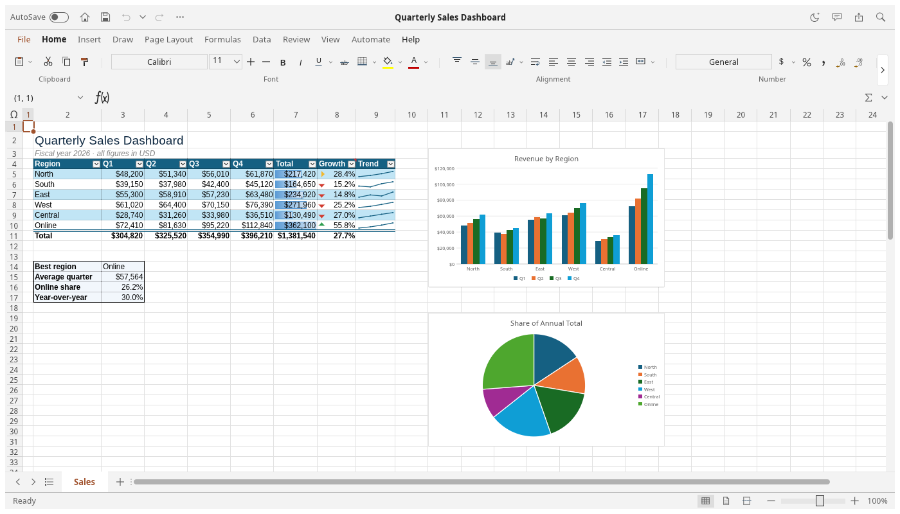
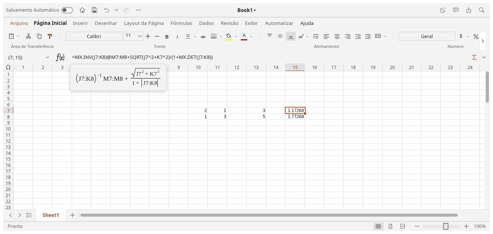
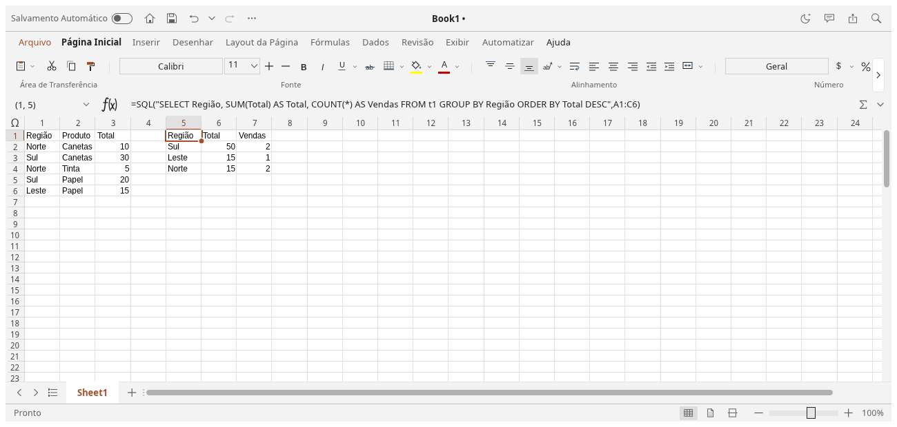
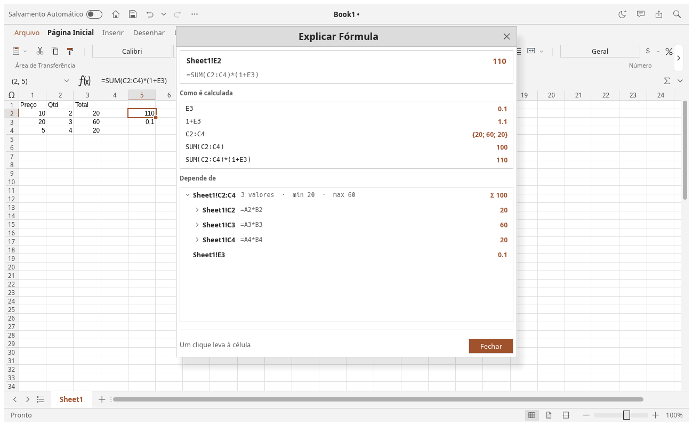
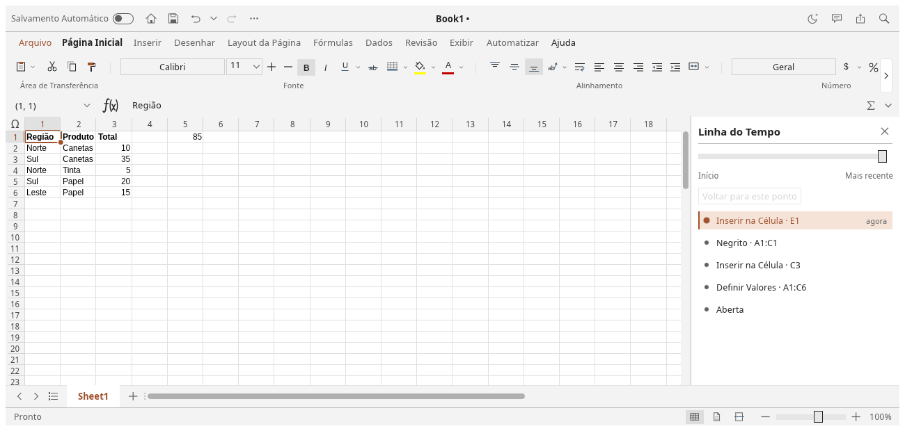
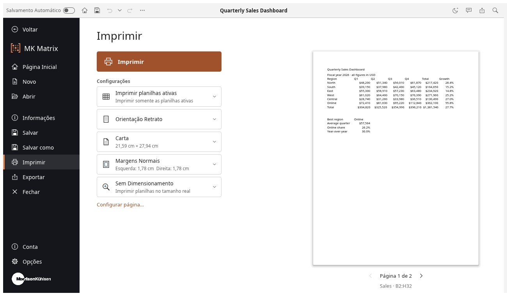
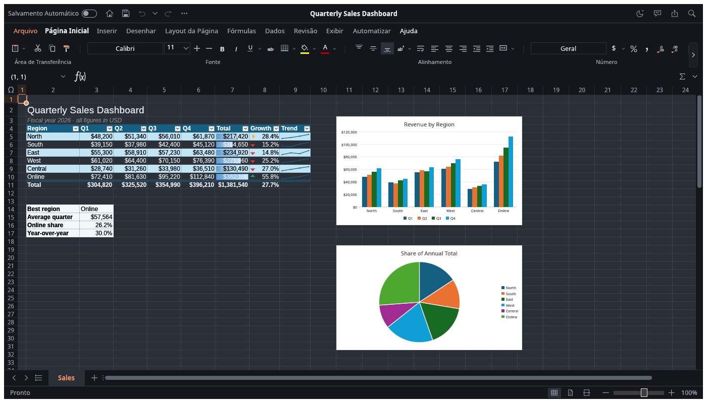

<p align="center">
  
</p>

<h1 align="center">MK Matrix</h1>

<p align="center">
  <b>Spreadsheets of matrices: every cell a number, every block an algebra.</b><br>
  <i>Numero, pondere et mensura.</i> · A Morrison Kühlsen project.
</p>

MK Matrix is a spreadsheet whose methodology is linear algebra. A spreadsheet is good at showing
and touching numbers and poor at matrix mathematics; MATLAB, R, Julia and NumPy are the reverse.
MK Matrix keeps the cell grid and makes matrices first-class, so a regression is
`β = (X'X)⁻¹X'y` over blocks you can see, and every change recalculates in place.

It is a fork of [GridCraft](https://github.com/storytold/gridcraft), a clean-room, Rust-native
spreadsheet, and inherits its engine, file formats (XLSX in and out), charts, command system,
CLI, MCP server and WebAssembly build. It runs natively on macOS, Windows, Linux and BSD, and in
the browser.

## A look around

<p align="center">
  
</p>

<table>
  <tr>
    <td width="50%"></td>
    <td width="50%"></td>
  </tr>
  <tr>
    <td><b>Formulas as mathematics.</b> The Σ button at the formula bar's end draws the formula as maths: fractions, exponents, radicals, A⁻¹, Aᵀ, A⁻¹b for <code>A\b</code>, matrices in brackets.</td>
    <td><b><code>=SQL()</code> over ranges.</b> <code>SELECT … FROM t1 [JOIN t2] WHERE … GROUP BY … ORDER BY …</code> on the sheet's own tables; the result spills and recalculates.</td>
  </tr>
  <tr>
    <td></td>
    <td></td>
  </tr>
  <tr>
    <td><b>Explain Formula.</b> Why a cell shows what it does: its evaluation steps, then the tree of everything it reads, down to the data.</td>
    <td><b>History.</b> The workbook's timeline: choose any step to see how the sheet stood then, and go back to it.</td>
  </tr>
  <tr>
    <td></td>
    <td></td>
  </tr>
  <tr>
    <td><b>Print.</b> Settings as cards beside a full-height preview, acting on the sheet's Page Setup.</td>
    <td><b>Dark mode</b>, and a floating formula bar (F2, or Ctrl twice) for those who want the sheet to themselves.</td>
  </tr>
</table>

## Where it is going

1. **Rebrand** (done): MK Matrix's name, mark and splash screen, in the Morrison Kühlsen house style.
2. **Numerics**: a pure-Rust linear-algebra library (LU, QR, SVD, eigenvalues) under the functions.
3. **Matrix syntax**: `*` as the matrix product between matrices, `A'` for the transpose, `A\b` to
   solve a system, and `inv`, `det`, `eig`, `svd`, `solve`.
4. **Named matrices**: `A = B2:D4`, used by name in formulas, with results that spill onto the grid.

Who it is for: statistics and econometrics (regression, covariance, PCA), teaching linear algebra,
engineering systems (`Ax = b`, Markov chains, input–output models) and portfolio work.

## Quick start

```sh
cargo run --release -p mkmatrix                              # desktop app
cargo run --release -p mkmatrix -- --sample sales            # open a sample (sales, budget, grades)
cargo run --release -p mkmatrix -- book.xlsx                 # open a workbook
cargo run --release -p mkmatrix -- --sample sales --control 7979   # + JSON control channel
cargo xtask ci                                                 # fmt, clippy, tests, assets, layering, wasm
```

Choose Español under View → Interface language for [Spanish formula names, decimal commas, and semicolon arguments](docs/formula-input.md).
Workbooks, clipboard exchange, and programmatic APIs retain canonical English syntax.

### Web

```sh
cd apps/mkmatrix-web && trunk build --release     # → dist/web (serve it with any static server)
cd apps/mkmatrix-web && trunk serve --release     # http://127.0.0.1:8771  (?sample=sales opens a sample)
```

You need [trunk](https://trunk-rs.github.io/trunk/) and the `wasm32-unknown-unknown` target. Open uses the
browser's file picker (dropping files works too) and Save downloads the workbook.

### Ribbon access keys

Press and release **left Alt** on Windows/Linux/BSD, or press **F10** on any platform,
then type a sequence below one key at a time. Keytips appear on the supported Home
controls and menu items. On macOS, use F10 (Fn+F10 if required by your keyboard); Option
remains available for entering accented characters.

| Sequence after Alt/F10 | Action |
|---|---|
| `H A L` / `H A C` / `H A R` | Align left / center / right |
| `H V S` or legacy `E S` | Open Paste Special |
| `H O I` or legacy `O C A` | AutoFit selected columns |

In Paste Special, **T/V/F/C** select formats/values/formulas/comments, and **E** toggles
Transpose. **Enter** applies the selected options; **Escape** cancels the dialog.
These letters also work with Alt held on Windows/Linux/BSD.

Escape backs out one keytip level; Alt/F10 again exits keytips. Clicking, scrolling,
or switching windows cancels navigation. Access keys do not start while editing text
or using another dialog. This is initial support for these Home and legacy paths;
other ribbon commands and full mouse-free navigation remain to be implemented.
Browsers or desktop environments may reserve Alt/F10 for their own menus.

### Logs

The desktop app writes its log to standard error and to `mkmatrix.log` in the `logs` folder
next to its settings: `~/.config/mkmatrix/logs` on Linux and BSD (`$XDG_CONFIG_HOME/mkmatrix/logs`
when set), `~/Library/Application Support/MK Matrix/logs` on macOS and
`%APPDATA%\MK Matrix\logs` on Windows. Each start moves the previous log to `mkmatrix.1.log` and
that one to `mkmatrix.2.log`, so the log of a run that crashed survives the next start; attach
them to a bug report. A log file stops growing at 16 MiB. By default MK Matrix's own crates log
at `info` and everything else at `warn`; `RUST_LOG` replaces that with env_logger-style
directives, e.g. `RUST_LOG=debug` or `RUST_LOG=warn,mkmatrix_engine=debug` (a trailing `*`
matches a prefix: `mkmatrix*=debug`). Runs with `MKMATRIX_NO_PREFS` set (no saved settings)
log to standard error only.

## For agents: MCP, CLI and the control channel

```sh
claude mcp add mkmatrix -- mkmatrix-cli mcp                 # headless MCP server
mkmatrix-cli mcp --connect 7979                               # MCP bridged to a running window
mkmatrix-cli eval '=XLOOKUP("b",{"a","b"},{1,2})'             # → 2
mkmatrix-cli run --sample budget --cmd 'home.bold={"range":"B4:F4"}' --out budget.xlsx
mkmatrix-cli cat budget.xlsx --range B4:F15                   # aligned text table
mkmatrix-cli commands --search chart                          # every command and its params
```

The MCP server offers tools such as `read_range`, `write_range`, `set_cell`, `evaluate_formula`,
`format_range`, `insert_chart`, `create_table`, `sort_range`, `filter` and `execute_command`
(which reaches every one of MK Matrix's commands). The desktop app's control channel adds real
pointer and keyboard input, dialogs and screenshots. See [`docs/mcp.md`](docs/mcp.md),
[`docs/cli.md`](docs/cli.md) and [`docs/control-protocol.md`](docs/control-protocol.md).

## Architecture

MK Matrix is an engine-first Cargo workspace with enforced layering (`cargo xtask layers`). The
egui frontend is a separate crate, so the UI can be swapped without touching the engine.

| Layer | Crates |
|---|---|
| L0 | `core` (addresses, values, errors, dates, input parsing) · `numfmt` (number format codes) |
| L1 | `formula` (lexer, parser, printer, reference adjustment) · `functions` (worksheet function library) |
| L2 | `model` (workbook, sheets, copy-on-write cells, styles, tables, charts…) · `calc` (dependency graph, evaluator, dynamic arrays) · `xlsx` (XLSX, CSV, plus XLSB and ODS data import) |
| L3 | `chart` (toolkit-free chart layout and rendering) |
| L5 | `engine` (session, commands, history, clipboard, fill, sort, filter, file I/O) |
| L6 | `ui-egui` (spreadsheet UI, control channel) · `mcp` (MCP server) |
| L7 | `apps/mkmatrix`, `apps/mkmatrix-cli`, `apps/mkmatrix-web` |

- **Contributor and agent rules** (clean-room, asset policy, never-crash, quality gates): [`AGENTS.md`](AGENTS.md)
- **Bundled assets:** each one is listed with its licence in [`ATTRIBUTION.md`](ATTRIBUTION.md)
- **Releases:** signed macOS, Windows, Linux, BSD and web builds; see [`docs/releasing.md`](docs/releasing.md)

## Roadmap

MK Matrix is in **alpha**: the core workflow works end to end, but depth, fidelity and file
compatibility are still rough. It covers 89% of standard ribbon commands in our catalog
([`docs/parity-checklist.md`](docs/parity-checklist.md)) and 513 standard worksheet functions
([`docs/function-parity.md`](docs/function-parity.md)); this is a parity inventory, not a count of working implementations. Weighted by what spreadsheet users rely on, we
estimate it is about 50% ready for real work. Next up: XLSX fidelity on real-world files, very large
workbooks and multi-threaded recalc, chart depth, text in every script, and `.xls` import. Stage,
numbers and estimates are in [ROADMAP.md](ROADMAP.md); the ranked work list is [`docs/gaps.md`](docs/gaps.md).

## License and credits

MK Matrix is dual-licensed under [MIT](LICENSE-MIT) or [Apache-2.0](LICENSE-APACHE), at your option.
Copyright (c) 2026 Morrison Kühlsen and the MK Matrix contributors; GridCraft, which it is forked
from, is Copyright (c) 2026 ArtCraft Team and the GridCraft contributors. Required notices are in
[NOTICE](NOTICE).

Bundled assets keep their own licenses; each one is listed with its author, source and license in
[ATTRIBUTION.md](ATTRIBUTION.md). The UI icons, the mark and the splash screen's artwork are drawn in
code and are original.

The Morrison Kühlsen name and wordmark in [`docs/brand/`](docs/brand/) are Morrison Kühlsen brand
assets, used with their owner's permission and not covered by the code's licenses
([`docs/brand/LICENSE.md`](docs/brand/LICENSE.md)).
